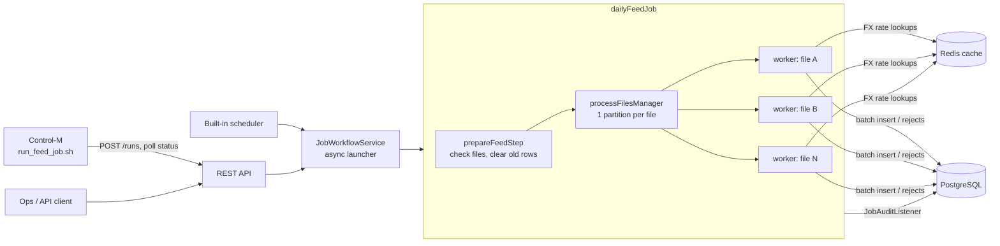

# Batch & Workflow Automation Engine


A Spring Boot + Spring Batch service that **triggers, monitors and audits** large data-processing jobs. It can be driven by its REST API, its own cron scheduler, or an enterprise scheduler such as **BMC Control-M**.

The sample job, `dailyFeedJob`, loads each day's transaction feed files. It validates every record, converts amounts to GBP using cached FX rates, and loads the results into PostgreSQL. All feed files are processed **in parallel**, and every rejected record is kept with the reason it was rejected.

> This is a personal portfolio project. It rebuilds, in open-source form, the kind of batch orchestration I worked on at Infosys (Spring Batch + Control-M). It contains no client or employer code or data.

## Architecture



Each worker step reads its CSV file, then validates and enriches each record (`TransactionItemProcessor`), then batch-inserts the results (`JdbcBatchItemWriter`). Bad records are **skipped, not fatal**: `RejectedRecordListener` stores them in `rejected_record`.

## Features

| Area | What it does |
|---|---|
| Parallel processing | Spring Batch **partitioning**: one partition per feed file, run on a thread pool (`engine.grid-size`) |
| Throughput | Chunk-oriented processing with JDBC **batch inserts** (`engine.chunk-size`) |
| Fault tolerance | Bad records (validation, parse errors, duplicate IDs) are skipped up to `engine.skip-limit` and stored with the reason |
| Idempotent re-runs | `prepareFeedStep` clears a business date's previous output, so re-running a day never duplicates data |
| Restart | A FAILED or STOPPED run restarts from the partition that failed, not from scratch |
| Audit trail | `job_audit` records who triggered each run (API / SCHEDULER / CONTROL_M), when, and the read / write / skip counts |
| Caching | FX reference rates cached in **Redis** with a TTL, which keeps the database out of the per-record path |
| Scheduling | Built-in cron trigger, or hand the schedule to **Control-M** (see [`controlm/`](controlm)) |
| Ops | Actuator health/metrics, RFC 7807 error responses, Flyway-managed schema |

## Tech stack

Java 17 · Spring Boot 3.3 · Spring Batch 5 · Spring Data JPA · PostgreSQL · Flyway · Redis · JUnit 5 · Mockito · H2 (tests) · Docker · GitHub Actions · JaCoCo

## Run it locally

You need Docker:

```bash
docker compose up --build
```

This starts PostgreSQL, Redis and the engine on `http://localhost:8080`, with `./sample-data` mounted as the inbound folder.

Trigger the sample feed for 20 Oct 2026:

```bash
curl -i -X POST http://localhost:8080/api/v1/jobs/dailyFeedJob/runs \
  -H 'Content-Type: application/json' \
  -d '{"runDate":"2026-10-20","triggeredBy":"raj"}'
```

The response is `202 Accepted`, with a `Location` header pointing at the run:

```bash
curl http://localhost:8080/api/v1/jobs/runs/1
curl "http://localhost:8080/api/v1/audit?jobName=dailyFeedJob"
```

The sample data has 11 records: 7 load successfully and 4 are rejected (a bad account ID, a negative amount, a future date, and an unknown currency).

## REST API

| Method | Path | Purpose |
|---|---|---|
| `GET` | `/api/v1/jobs` | List available jobs |
| `POST` | `/api/v1/jobs/{jobName}/runs` | Start a run. Body (all optional): `runDate`, `triggerSource`, `triggeredBy`, `forceRerun` |
| `GET` | `/api/v1/jobs/{jobName}/runs?count=10` | Recent runs, newest first |
| `GET` | `/api/v1/jobs/runs/{executionId}` | Status, exit code and per-step counts |
| `POST` | `/api/v1/jobs/runs/{executionId}/stop` | Stop a running execution at the next chunk |
| `POST` | `/api/v1/jobs/runs/{executionId}/restart` | Restart a FAILED / STOPPED execution |
| `GET` | `/api/v1/audit?jobName=&status=&page=&size=` | Paged audit trail |

Errors use `application/problem+json`. For example, `409 Conflict` means the date has already completed and you need to pass `forceRerun: true` to run it again.

## Control-M integration

In many enterprises the schedule lives in Control-M, not in the application. [`controlm/run_feed_job.sh`](controlm/run_feed_job.sh) is a wrapper for a Control-M OS job. It:

1. converts the Control-M order date (`%%$ODATE`, `yyyymmdd`) into the API's `runDate`
2. starts the run with `triggerSource=CONTROL_M`, so the audit trail shows Control-M started it
3. polls the run until it finishes and exits `0` (Ended OK) or non-zero (Ended Not OK)

This means Control-M's normal reruns, alerts and downstream conditions all work. [`controlm/daily-feed-job.json`](controlm/daily-feed-job.json) is an example job definition in Automation API format. It waits for the files-arrived event, adds a feed-loaded event for downstream jobs, and notifies support on failure.

## Configuration

| Property | Default | Meaning |
|---|---|---|
| `engine.input-base-dir` | `./sample-data` | Feeds are read from `<dir>/<runDate>/*.csv` |
| `engine.chunk-size` | `500` | Records per transaction |
| `engine.grid-size` | `4` | Files processed in parallel |
| `engine.skip-limit` | `1000` | Bad records tolerated per file |
| `engine.cache.fx-rates-ttl` | `PT1H` | Redis TTL for FX rates |
| `engine.scheduler.enabled` | `false` | Turn on the built-in cron trigger |
| `engine.scheduler.daily-feed-cron` | `0 0 6 * * MON-FRI` | When the built-in trigger runs (Europe/London) |

## Tests

```bash
mvn verify
```

- **Unit tests:** validation and conversion rules in `TransactionItemProcessor`, covering eight rejection cases plus rounding.
- **Integration tests:** the full job against H2. They cover parallel files, rejected records, duplicate IDs, an idempotent re-run, and a missing feed.
- **Web layer:** status codes, the `Location` header, and error mapping for the API.

The JaCoCo coverage report is written to `target/site/jacoco/` and uploaded by CI.

## Project layout

```
src/main/java/com/rajkumar/batchengine
├── config/      engine properties, thread pools, Redis cache
├── domain/      records, JPA entities, exceptions
├── job/         job + step definitions, processor, listeners
├── repository/  Spring Data JPA repositories
├── scheduler/   optional built-in cron trigger
├── service/     JobWorkflowService (launch / stop / restart / status), FX rates
└── web/         REST controllers and error handling
controlm/        Control-M wrapper script and job definition
sample-data/     example inbound feed files
```

## Author

**Raj Kumar Bonda**, Java Backend Engineer · [LinkedIn](https://www.linkedin.com/in/rajkumar-bonda-b6a579279/) · [GitHub](https://github.com/Rajkumar2119)
